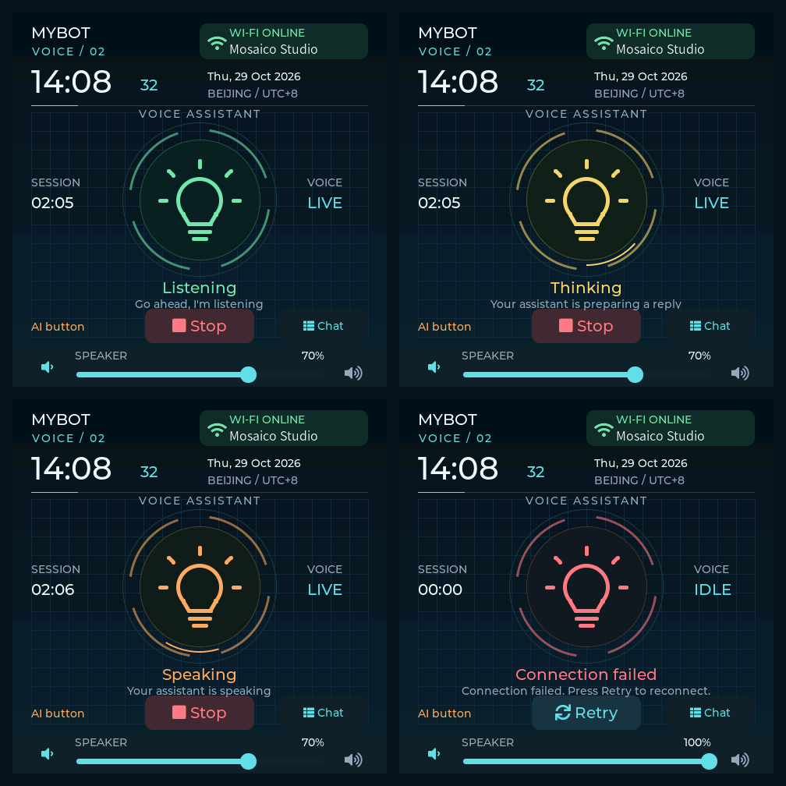
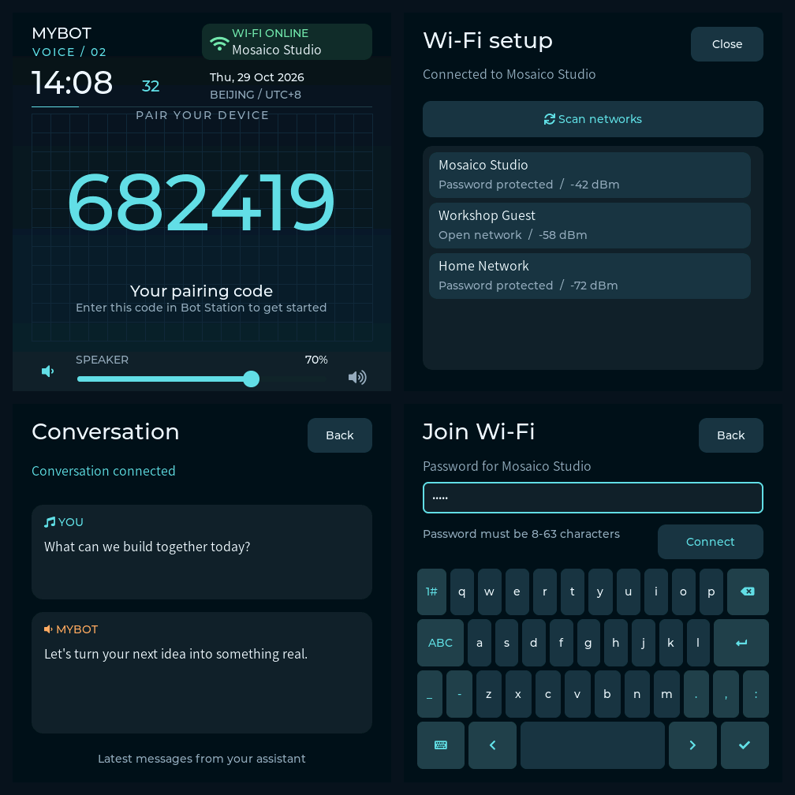

# V2 Screen Design

The Mosaico has a 480 x 480 touchscreen. The v2 design uses a midnight-blue
instrument panel, cyan accents, a fine coordinate grid, Montserrat headings,
and the existing CJK font for network names and messages. All graphics are LVGL
primitives, so the firmware needs no image assets or additional font downloads.

These previews are rendered by the production `main/ui.c` with the project's
LVGL 9.5 software renderer. The test clock, network names, pairing code and
messages are fixtures. These are host renders, not device photographs.

## Conversation States



| State | Bulb | Halo | Main control |
| --- | --- | --- | --- |
| Connecting | Cyan | Moving marker | Connecting, disabled |
| Listening | Green | Static | Stop |
| Thinking | Yellow | Moving marker | Stop |
| Speaking | Orange | Moving marker | Stop |
| Stopped | Gray | Static | Start |
| Stopping | Gray | Static | Stopping, disabled |
| Conversation error | Red | Static | Retry |

The bulb and its halo are centered at display coordinate (240, 240). The
session timer and voice connection label sit to either side; controls sit below
the bulb. The clock and network badge stay above it. Volume stays at the bottom.

The speaking indication uses agent state messages or actual local playback
activity. The moving marker communicates activity; it is not an audio-level
meter. Animations stop updating while a full-screen settings/message page
covers the dashboard. Static text and status styles update only when changed.

## Setup And Messages



- Pairing keeps the large six-digit code centered and hides the Start control.
- Binding confirmation still automatically starts the conversation once per boot.
- The Wi-Fi badge opens the existing scan/connect flow. Setup closes after a
  requested connection obtains an IP; simply inspecting settings keeps it open.
- Network names, security and RSSI appear in large touch rows. Shared row styles
  and direct text drawing support all 20 scan results within the existing pool.
  Closing setup releases the rows.
- The password page keeps masked entry, validation and the on-screen keyboard.
- Tapping the bulb or Chat opens the latest user and assistant message cards.
  Missing transcripts show a placeholder; the existing bounded transcript fields
  are used, so this view does not claim to preserve a complete conversation.
- The speaker icon toggles mute and restores the last nonzero volume. The
  slider remains adjustable during a conversation.

## Orange AI Button

The top orange application button is `BSP_BUTTON_AI`, GPIO 7, active low. A
debounced `BUTTON_SINGLE_CLICK` posts an atomic flag. The existing LVGL refresh
callback consumes it and uses the same start/stop/retry handler as the screen.
The button's timer callback performs no UI or HTTP work.

Starting/stopping transitions reject repeated commands. While unpaired, the
button does not start a conversation; a setup error can be retried. Without
Wi-Fi, it opens network setup. If button initialization fails, a warning is
logged and the screen controls remain available. The BOOT button is unchanged.

## Clock And Performance

The screen updates clock text once per second and applies UTC+8 for display.
SNTP, UTC timestamps, TLS/JWT authentication and the session task are unchanged.
Before valid network time, the screen shows `--:--` and a pending date. Session
duration uses the monotonic LVGL tick, so network clock corrections do not change
it. It starts when the UI observes `APP_RUNNING`, resets on a new start, and
retains the completed duration while stopped.

The UI keeps the device's 64 KiB LVGL allocation. Rings, glow and background
use draw primitives without a transformed or translucent screen-sized layer.
The dashboard refreshes at 100 ms; moving markers invalidate only the center.
No audio, AEC, Wi-Fi protocol, pairing, API, RTC, or server VAD code is modified.

## Verification

Build the firmware:

```sh
bash scripts/idf.sh build
```

Run the host UI regression and regenerate PNG previews (CMake, Clang and Python 3;
the project's downloaded LVGL dependency must be present):

```sh
bash tests/ui/run_ui_tests.sh
```

Output is under `build-ui-host/previews/`. The harness runs the actual widgets
and callbacks with real RGB565 rendering and a fixed 64 KiB pool. It checks:

- Pairing, automatic-start pending state, setup retry and conversation errors.
- Center alignment and all status colors, including local playback fallback.
- Shared screen/AI-button control, transition guards and missing-button fallback.
- Volume limits, live slider updates and restoration after mute.
- Wi-Fi inspection, secure/open AP selection, password validation, successful
  connection, failure recovery, 20 results, scrolling and repeated scans.
- Clock formatting, UTC+8 date rollover, session duration and latest messages.
- Repeated animated frames with AddressSanitizer/UndefinedBehaviorSanitizer.
  LVGL's generic mask callback requires disabling its function-type sanitizer;
  other checks remain enabled.

On-device acceptance still needs a flash and a check of display refresh under
full-duplex audio, touch targets, the physical orange button, Wi-Fi recovery,
pairing/automatic start, volume/mute, and Stop/Start. Host tests cannot establish
speaker/microphone behavior or the physical switch wiring on a particular board.
