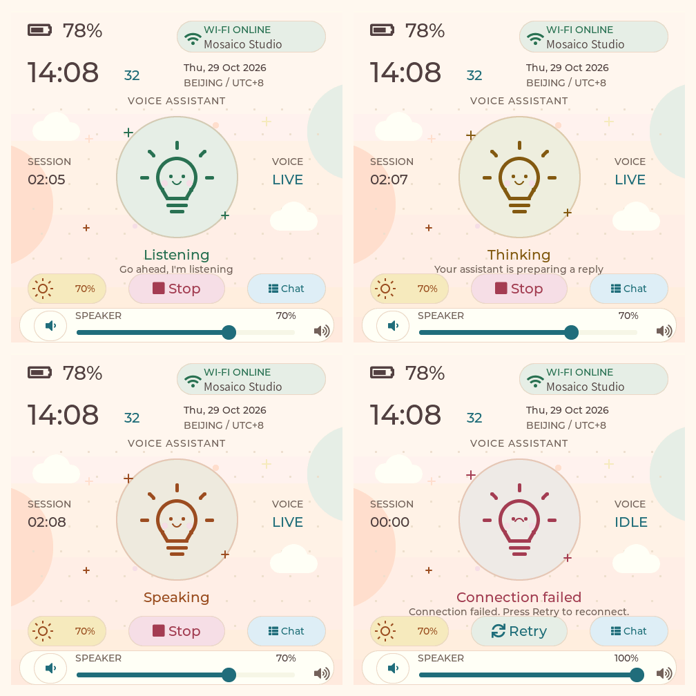
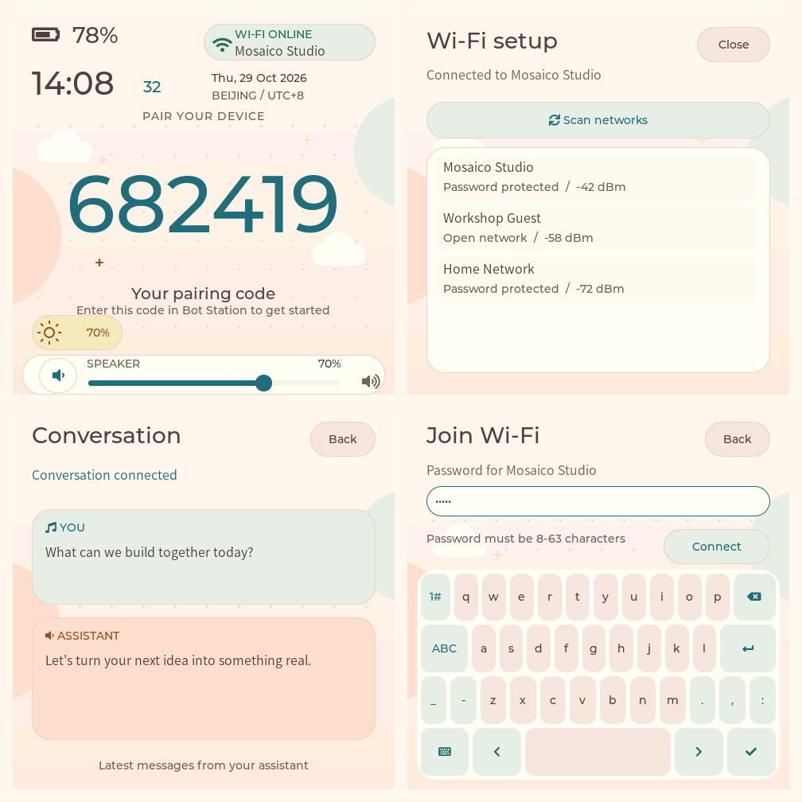
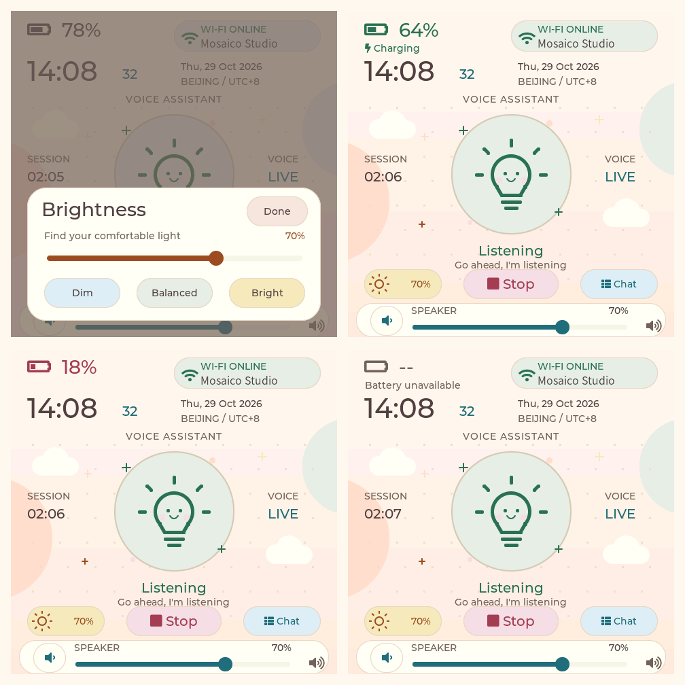

# V3 Display And Power Controls

The dashboard keeps the 480 x 480 layout with a warm, playful visual theme:
cream-to-peach backgrounds, quiet polka dots, little clouds and rounded pastel
controls. Mint, pink, butter yellow and pale blue identify the controls, while
dark cocoa and deeper accent colors keep text legible on the light surfaces.
The same background treatment appears on Wi-Fi setup, password entry and the
conversation page, including rounded keyboard keys and message cards.

The centered bulb becomes a smiling companion with rosy cheeks, a soft round
badge and small floating sparkles while connecting, thinking or speaking.
Its existing state colors remain; errors use a small frown and red accent.
Decorations use native draw primitives, without downloaded fonts, raster assets
or full-screen opacity layers.

The brand wordmark is removed. A large battery icon and percentage occupy its
former position at the top left, using the same 28 px font. Charging, full and
unavailable status appear on a smaller line below, keeping the large reading
clear of the Wi-Fi badge on the right. The clock, date and centered bulb retain
their positions. While the assistant speaks, only the `Speaking` caption is
shown; the duplicate sentence beneath it is removed. Connecting and stopping
also show only their status captions. The idle caption is `Ready to go`, with
no extra instruction below it.



The bottom controls form a balanced row: brightness on the left, the compact
Start/Stop button in the middle, and Chat on the right. The speaker volume rail
remains beneath them. The former AI-button caption is removed; the physical
orange button still starts/stops the conversation, including while the brightness
sheet is open.



## Brightness



Tap the sun/percentage button to open the brightness sheet. It provides a 10-100
percent slider and three presets: Dim (20%), Balanced (70%) and Bright (100%).
The minimum keeps the touch interface visible. Tap Done or outside the card to
close it. A hardware adjustment failure restores the previous value and shows
an error in the sheet.

Brightness commands use `bsp_display_brightness_set`, serialized on the LVGL
task. Drag updates are coalesced by the existing 100 ms refresh; release and
preset taps apply immediately. Screen-sized opacity layers are avoided: the
scrim uses only background opacity and the existing partial RGB565 renderer.

The low-priority power task stores `display/brightness` in NVS after one second
without changes. It does not write flash on every drag event. Failed writes
retry after five seconds. Startup restores a valid 10-100 setting, or defaults
to 70%. Display, storage or monitoring failures do not stop the conversation.

## Battery

The same background task polls the board's BQ27220 at address 0x55 every five
seconds using the BSP-owned I2C bus. The dashboard only copies cached status;
its refresh callback does no battery I2C work. Every transaction has a 50 ms
timeout and its return value is checked.

Only the standard Voltage, BatteryStatus, Current and StateOfCharge registers
are read. No fuel-gauge profile, capacity, calibration or control commands are
written. Percentage accuracy follows the gauge's existing configuration and
learning state.

| Reading | Display |
| --- | --- |
| Valid battery, 0-100% | Battery icon and percentage |
| 20% or below, not charging | Red battery status |
| Positive charge current, no discharge/inhibit/full flag | Green charging indication |
| Full flag | Green full indication |
| Gauge reports no battery | No battery |
| Gauge unavailable, I2C failure, invalid SOC/voltage | Battery icon, -- and Battery unavailable |

The charging indicator reflects battery current, rather than assuming that USB
attachment means the cell is charging. An unsuccessful sample clears the cached
charge indication until a valid reading returns.

## Verification

The existing host test command now covers the actual power service as well as
production UI callbacks and real LVGL rendering:

```sh
bash tests/ui/run_ui_tests.sh
bash scripts/idf.sh build
```

Tests cover checked read-only register access, byte order, charging/full/absent/
unavailable states, gauge recovery, brightness validation and hardware failures,
preference restoration, delayed writes and retry. UI tests exercise the sheet,
presets, closing, slider errors, battery badges, physical-button operation while
adjusting brightness, and the previous pairing/conversation/volume/Wi-Fi flows.
The original 64 KiB LVGL pool and sanitizers remain enabled, including 20 AP
results and repeated animated rendering.

Generated previews are under `build-ui-host/previews/`; the images in this
document use fixture battery and clock data from that renderer. The v2 preview
files remain as the design baseline. Real-device acceptance still needs to
verify CO5300 brightness changes, persisted brightness after reboot, actual
battery/charging readings and uninterrupted duplex audio while adjusting.
